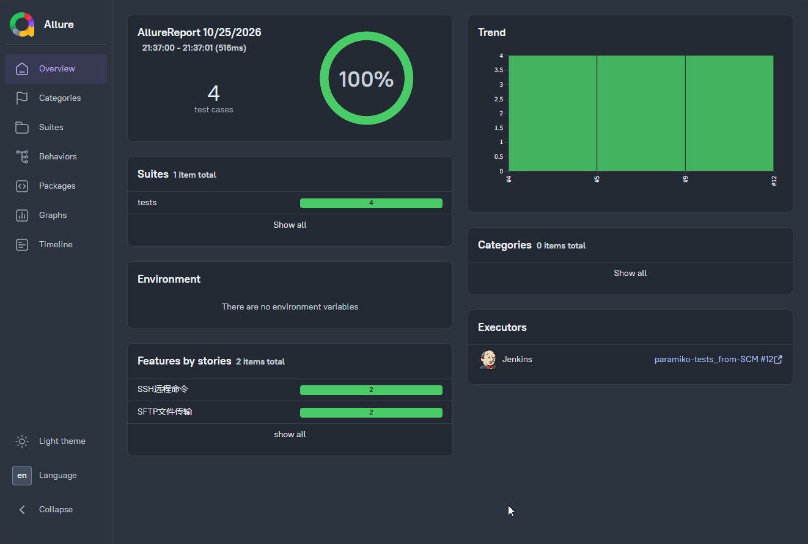
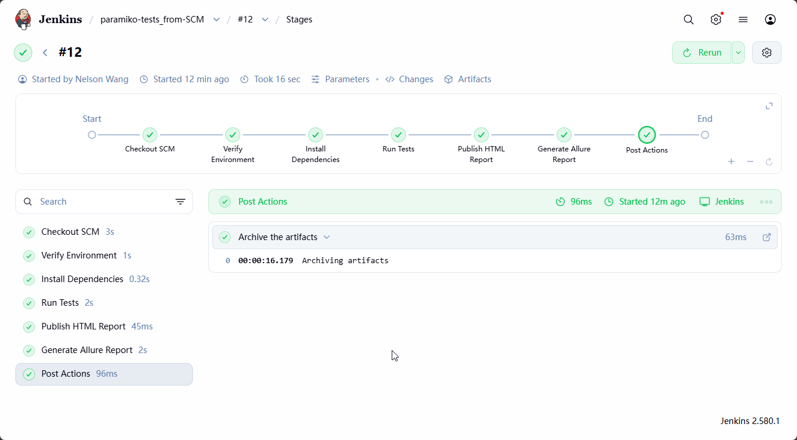
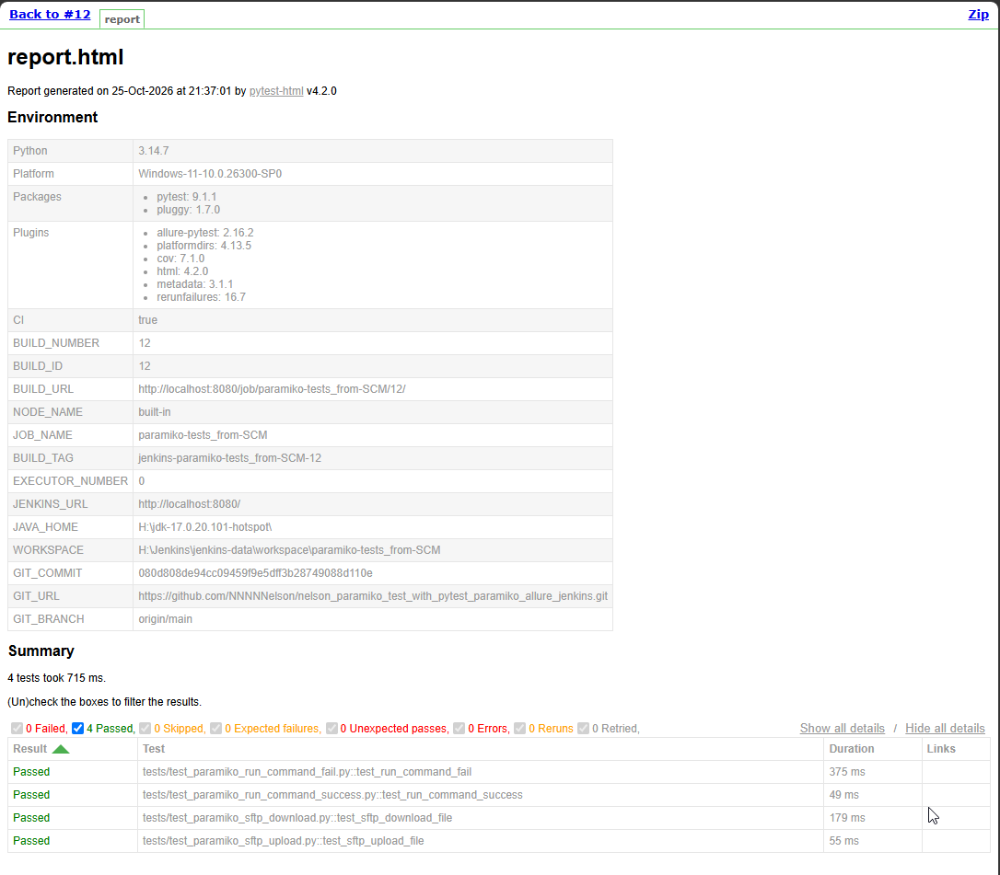

# Python + Pytest + Paramiko + Allure + Jenkins 集成测试 Demo


一个端到端的 Paramiko (SSH/SFTP) 集成测试工程实践 Demo。从本地 pytest 单测 → Jenkins Pipeline CI/CD → Allure 可视化报告，简单复现之前在汇丰测试团队的自动化测试工作流。

> 🏢 **背景**: 项目设计重现并优化汇丰软件开发内部 QA 团队的自动化测试和 CI/CD 流程，目标是构建一个可直接用于面试展示的、"企业级可迁移"的测试工程样例。

---

## ✨ 项目亮点

| #   | 亮点                     | 对企业的价值                                                        |
| --- | ------------------------ | ------------------------------------------------------------------- |
| 1   | **完整 CI/CD Pipeline**  | Jenkins 从 GitHub 拉取代码 → 自动配置依赖 → 执行测试 → 生成双份报告 |
| 2   | **双报告体系**           | pytest-html (快速预览) + Allure (结构化可视化仪表盘)                |
| 3   | **Allure 装饰器**        | 测试用例按 `feature / story` 分组，直接映射产品需求                 |
| 4   | **pytest-rerunfailures** | 集成测试天生有网络抖动，自动重跑避免偶发失败                        |
| 5   | **凭据安全管理**         | Jenkins Credentials + `withCredentials` 注入，密码绝不硬编码        |
| 6   | **Markers 分类**         | `smoke` / `integration` 标记支持选择性执行                          |
| 7   | **uv 包管理**            | 比 pip 快 10-100 倍，企业项目标准实践                               |

---

## 🏗️ 技术栈

```
├── 测试框架:     pytest (9.1+) + pytest-html + pytest-rerunfailures
├── 报告生成:     allure-pytest (2.16+) + pytest-cov
├── 包管理:       uv
├── CI/CD:        Jenkins 2.580+ (Declarative Pipeline)
├── 目标服务:     WSL SSH (OpenSSH Server) on Windows
├── 远程客户端:   Paramiko 5.x
├── 配置管理:     python-dotenv
├── 代码质量:     ruff + black
└── 版本控制:     Git + GitHub
```

---

## 🔄 CI/CD 架构图

```
GitHub Repository
┌────────────────────────────────┐
│ 源代码 / Jenkinsfile / 测试用例 │
└──────────────┬─────────────────┘
               │ git clone
               ▼
Jenkins Agent (Windows)
┌──────────────────────────────────┐
│ ① Checkout SCM  (自动拉代码)      │
│ ② Verify Env    (工具版本确认)    │
│ ③ Install Deps  (uv sync)        │
│ ④ Run Tests     (withCredentials)│
│ ⑤ Publish HTML  (pytest-html)    │
│ ⑥ Generate Allure                │
│ ⑦ Archive Artifacts              │
└──────┬──────────────┬────────────┘
       │              │
       ▼              ▼
┌────────────┐   ┌──────────────┐
│ pytest-html│   │ Allure 仪表盘 │
│ report.html│   │ allure-report│
└────────────┘   └──────────────┘
```


> 👆 **Allure Dashboard**：4 个测试用例全部通过，Features 按 SSH 远程命令 / SFTP 文件传输分组，点击每个 Suite 可进入单条用例的执行步骤追溯

---

## 📁 目录结构

```
nelson-paramiko-tests/
├── Jenkinsfile                  # Jenkins Declarative Pipeline 定义
├── pyproject.toml               # 项目元数据 + pytest/ruff/black 配置 (单源配置)
├── uv.lock                      # uv 锁定依赖版本 (类似 package-lock.json)
├── .env.example                 # 环境变量模板 (SSH 凭据示例)
├── .gitignore                   # 忽略 .env / reports / allure-results 等
│
├── conftest.py                  # pytest fixtures (ssh_client / sftp_client / clean_up)
├── constants.py                 # 跨平台路径常量 (Windows ↔ WSL)
├── utils.py                     # MD5 校验 / 路径转换等工具函数
│
├── tests/                       # 测试用例目录 (testpaths)
│   ├── test_paramiko_run_command_success.py  # SSH 命令成功场景
│   ├── test_paramiko_run_command_fail.py     # SSH 命令失败场景
│   ├── test_paramiko_sftp_download.py        # SFTP 文件下载
│   └── test_paramiko_sftp_upload.py          # SFTP 文件上传
│
├── test_data_files/             # 测试用数据文件
│   ├── source_data_files/       # 源文件 (上传 / 下载测试用)
│   └── destination_data_files/  # 目标文件 (生成后不自动清理，方便排查)
│
└── docs/
    └── CICD_FLOW.md             # CI/CD Pipeline 详细解读
```

---

## 🖥️ 本地环境准备

| #   | 工具       | 版本要求          | 安装方式                                                 | 验证                               |
| --- | ---------- | ----------------- | -------------------------------------------------------- | ---------------------------------- |
| 1   | Python     | 3.12+             | `uv python install 3.12`                                 | `python --version`                 |
| 2   | uv         | 最新              | `winget install astral-sh.uv`                            | `uv --version`                     |
| 3   | Java       | 17+               | `winget install Microsoft.OpenJDK.17`                    | `java -version`                    |
| 4   | Allure CLI | 2.46+             | scoop / GitHub releases                                  | `allure --version`                 |
| 5   | Git        | 2.x               | `winget install Git.Git`                                 | `git --version`                    |
| 6   | WSL        | 含 OpenSSH Server | Windows Features → 勾选 "适用于 Linux 的 Windows 子系统" | `wsl -e service ssh status`        |
| 7   | Jenkins    | 2.580+            | `winget install Jenkins.Jenkins`                         | 浏览器打开 `http://localhost:8080` |

### Jenkins 必需插件

| 插件           | 作用                            |
| -------------- | ------------------------------- |
| Pipeline       | Declarative Pipeline 骨架       |
| Git Plugin     | 拉取 GitHub 代码                |
| Allure         | 生成 Allure 仪表盘              |
| HTML Publisher | 在 Jenkins 页面嵌入 pytest-html |
| Timestamper    | Console Output 加时间戳         |

### Jenkins Global PATH 配置

Jenkins 作为 Windows 服务运行，PATH 与 PowerShell 不同。在 **Manage Jenkins → System → Global properties → Environment variables** 添加：

```
PATH = C:\Users\<你的用户名>\.local\bin;H:\allure-2.46.0\bin;C:\Python314;C:\Python314\Scripts;%PATH%
```

### Jenkins Tools 配置

**Manage Jenkins → Tools**：

| Section                                       | Value                                             |
| --------------------------------------------- | ------------------------------------------------- |
| Git installations → Path to Git executable    | `C:\Program Files\Git\cmd\git.exe` (你的实际路径) |
| Allure installations → Name                   | `allure-2.46`                                     |
| Allure installations → Installation directory | `H:\allure-2.46.0`                                |

### Jenkins Credentials

**Manage Jenkins → Credentials → Global → Add Credentials**：

| Field    | Value                  |
| -------- | ---------------------- |
| Kind     | Username with password |
| ID       | `paramiko-ssh-creds`   |
| Username | 你的 WSL SSH 用户名    |
| Password | 你的 WSL SSH 密码      |

> ⚠️ ID 必须和 Jenkinsfile 里 `withCredentials` 的 `credentialsId` 完全一致。

---

## 🚀 本地运行

```bash
# 1. 克隆仓库
git clone <你的 GitHub 仓库地址>
cd nelson_paramiko_test_with_pytest_paramiko_allure_jenkins

# 2. 安装依赖
uv sync --all-extras

# 3. 配置 SSH 凭据（不要提交 .env）
# Windows PowerShell:
Copy-Item .env.example .env
# Linux/Mac:
# cp .env.example .env

# 编辑 .env 填入真实的 SSH_USER / SSH_PWD

# 4. 跑全量测试（含 rerun 重跑 + pytest-html + allure-results）
uv run pytest

# 5. 生成 Allure 静态报告
allure generate allure-results -o allure-report --clean

# 6. 本地预览 Allure 仪表盘
allure open allure-report
```

### 选择性执行

```bash
# 只跑冒烟测试
uv run pytest -m smoke

# 只跑集成测试
uv run pytest -m integration

# 只跑单个测试文件
uv run pytest tests/test_paramiko_sftp_download.py -v
```

### pytest markers

| Marker        | 说明                       | 测试数量 |
| ------------- | -------------------------- | -------- |
| `smoke`       | 冒烟测试 — 仅 SSH 命令     | 2/4      |
| `integration` | 集成测试 — 覆盖 SSH + SFTP | 4/4      |

Markers 定义在 `pyproject.toml → [tool.pytest.ini_options] → markers`。

---

## 🔧 Jenkins CI/CD Pipeline

Jenkinsfile 定义了 5 个 Stage + Declarative Checkout SCM。详细代码解读见 [`docs/CICD_FLOW.md`](docs/CICD_FLOW.md)。

| Stage                      | 核心动作                              | 关键技术点                                     |
| -------------------------- | ------------------------------------- | ---------------------------------------------- |
| **Checkout SCM**           | 自动从 GitHub 拉取代码                | Jenkins Git Plugin，凭据 Token 认证            |
| **Verify Environment**     | 打印 python / uv / allure 版本        | 快速诊断 PATH 问题                             |
| **Install Dependencies**   | `uv sync --all-extras`                | 比 pip 快 100x，lock 文件保证可重现            |
| **Run Tests**              | `withCredentials` 注入 SSH → `pytest` | 密码自动打码，rerun 防止偶发失败               |
| **Publish HTML Report**    | `HTML Publisher` 插件                 | pytest-html 报告嵌入 Jenkins 页面              |
| **Generate Allure Report** | `allure` step                         | 新版 Allure Plugin（org.allurereport.jenkins） |


> 👆 **Jenkins Pipeline 执行结果**：5 个 Stage 全部绿色通过，`Run Tests` 阶段显示 pytest 成功，`Generate Allure Report` 阶段报告生成无异常

### Jenkins Pipeline Job 配置

1. Jenkins 主页 → **New Item**
2. **Name**: `paramiko-tests`
3. **Type**: Pipeline → OK
4. **Pipeline Section**:
   - Definition: **Pipeline script from SCM**
   - SCM: Git
   - Repository URL: 你的 GitHub HTTPS URL
   - Credentials: 你的 GitHub Token（如果私有仓库）
   - Branch Specifier: `*/main`
   - Script Path: `Jenkinsfile`（不要改）
5. Save → **Build Now**

---

## 📊 报告类型说明

| 报告            | 生成方式                                         | 位置                       | 特点                                               |
| --------------- | ------------------------------------------------ | -------------------------- | -------------------------------------------------- |
| **pytest-html** | `--html=reports/report.html`                     | `reports/report.html`      | 单文件、快速预览、Jenkins HTML Publisher 嵌入      |
| **Allure**      | `--alluredir=allure-results` + `allure generate` | `allure-report/index.html` | 结构化仪表盘、feature/story 分组、趋势图、历史对比 |
| **测试日志**    | `log_file = "reports/test_run.log"`              | `reports/test_run.log`     | 完整 INFO 级别日志，调试问题首选                   |


> 👆 **pytest-html 报告**：与 Allure 形成互补——单文件 HTML 直接预览，快速定位失败用例；Allure 则提供跨构建的历史趋势和结构化分析

### Allure 仪表盘亮点

- **Feature 分组**: 按 `SSH 远程命令` / `SFTP 文件传输` 展示
- **Story 层级**: 每个 feature 下按成功/失败、上传/下载分组
- **趋势图**: 多次构建的通过率变化
- **步骤追溯**: 每个失败用例可以看到具体哪步报错

---

## ⚠️ 常见问题 FAQ

**Q: Jenkins 构建时报 `'git' is not recognized`？**
A: Jenkins Git Plugin 内部用绝对路径调用 git.exe，但不会加到 Jenkins PATH。解决方案：在 Jenkins Global PATH 里加 git 目录，或者不在 Verify Environment 里调用 git。

**Q: Jenkins Build 失败，全是 `ClassCastException`？**
A: 99% 是 Allure Plugin 版本和 Jenkinsfile 参数类型不匹配。读堆栈第一行：`expected XXX but received YYY` —— 直接告诉你要什么类型。新版 Allure Plugin（org.allurereport.jenkins）的 `results` 是 `[[path: 'xxx']]` 对象数组，`report` 是单个字符串。

**Q: Jenkins 里 `withCredentials` 怎么工作的？**
A: 进入块时 Jenkins 从 Credentials Store 解密密码 → 设置环境变量 SSH_USER/SSH_PWD → 执行命令 → 退出块立即清除。Console Output 里密码会自动打码。Python 里 `os.getenv()` 直接取值。

**Q: 为什么不把 .env 提交到 git？**
A: `.env` 包含明文密码。`.env.example` 里放占位符（`your_username_here`），新人 clone 后复制一份改成自己的。

**Q: `pytest-rerunfailures` 和 Jenkins `post { failure }` 重跑有什么区别？**
A: pytest-rerunfailures 在同一个 Stage 内重跑，用例级别重试；Jenkins failure 重跑是整个 Pipeline 重新执行。企业里两个都会配，但 pytest 插件级别更精细。

**Q: 为什么用 `uv` 不用 `pip`？**
A: `uv` 由 Astral（ruff 团队）开发，Python 包管理全链路比 pip 快 10-100x。银行 CI Pipeline 对构建时间非常敏感 —— 快 1 分钟就是 100 个 Job 每天省 1.6 小时。

---

## 🤝 关于这个项目

这个 Demo 是我回顾之前银行测试项目中的Python + Pytest + Paramiko + Allure + Jenkins 过程中的完整实践记录。
这个项目中的动作只是一些基本操作的元动作, 实际测试过程中涉及更多的动作, 比如
- 预检测服务器状态以及测试所需服务的状态
- 预检测Database中测试条目所需配置是否已经是enable状态
- 预检测测试环境所需目录及权限是否存在且可读写
- 自动生成测试所需文件
- 轮询检测上游文件的处理情况, 超时自动判定为测试失败
- 轮询检测下游文件的收取情况, 超时自动判定为测试失败
- 返回测试结果接入Jenkins Pipeline Job, 并根据结果判断build成功/失败

**作者**: Nelson Wang  
**灵感来源**: 汇丰软件开发（广东）QA 团队 日常实践
