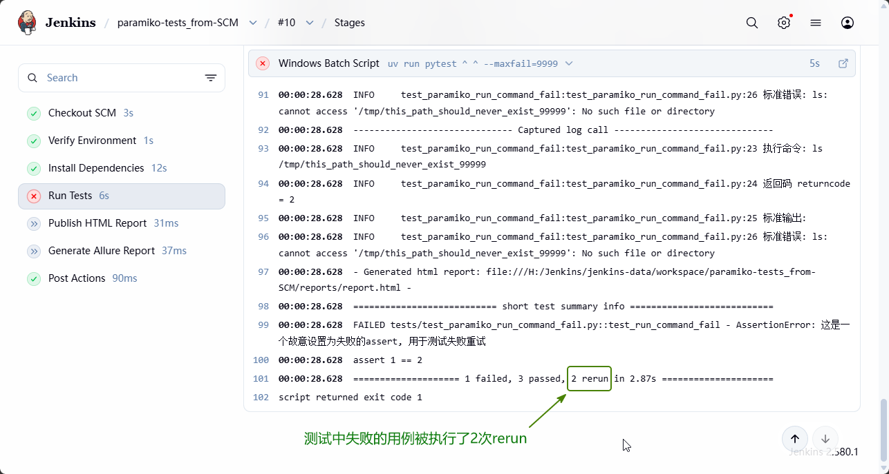
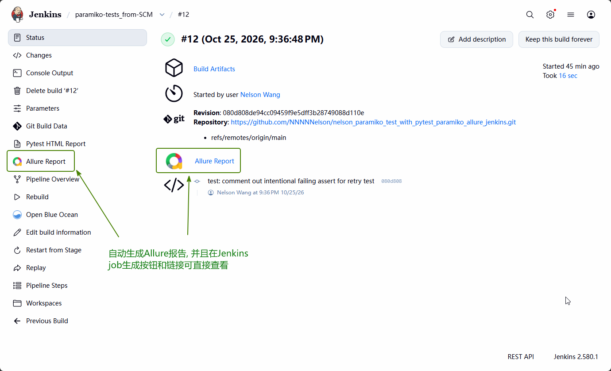

# CI/CD Pipeline 详细解读

本文档逐段解读 Jenkinsfile 的每个 Stage，记录踩过的坑和设计决策。

## Jenkinsfile 骨架

位置: [Jenkinsfile](../Jenkinsfile)

```groovy
pipeline {
    agent any

    environment {
        SSH_HOST = '127.0.0.1'
    }

    options {
        timeout(time: 30, unit: 'MINUTES')
        buildDiscarder(logRotator(numToKeepStr: '10'))
    }
    // ... (Declarative 自动 Checkout SCM + 5 个 Stage + post)
}
```

---

## Pipeline 逐段解读

### `agent any`

- `pipeline {}` 是 Declarative Pipeline 根结构（比 Scripted Pipeline 更严格、更推荐）
- `agent any` 表示可以在 Jenkins 集群的任意节点上运行。生产环境可能指定特定 Label：

```groovy
agent {
    label 'windows-py312'    // 只在安装了 Python 3.12 的 Windows Agent 上跑
}
```

### `environment { SSH_HOST = '127.0.0.1' }`

非敏感配置直接写 Jenkinsfile 里注入（`SSH_HOST` 是 IP 地址，不是密码）。敏感配置（用户名密码）必须走 Jenkins Credentials + `withCredentials`。

**为什么不把 SSH_HOST 也放 Credentials？** 因为它是静态值，不涉及敏感信息。Credentials 的设计初衷是保护密码/Token 这类可泄露凭据，静态环境变量用 `environment` block 更直观。

### `options { ... }`

| Option                    | 作用                    | 为什么要配                       |
| ------------------------- | ----------------------- | -------------------------------- |
| `timeout(30 min)`         | 超过 30 分钟自动中止    | 防止 Jenkins Agent 被长时间占用  |
| `buildDiscarder(keep 10)` | 只保留最近 10 次构建    | Jenkins 磁盘满是最常见的运维问题 |
| `timestamps()`            | 记录每个 Stage 开始时间 | 方便调试和分析 Pipeline 执行时间 |

踩过的坑：最早直接写了 `timestamps()` 作为 option，但测试中发现报错, 研究发现 Jenkins 2.580.1 把它移到了 Timestamper Plugin 作为 Pipeline Step/Wrapper，Declarative options 中使用的话, 需要先安装 Timestamper 插件。

---

## Checkout SCM（Declarative 内置 Stage）

**不在 Jenkinsfile 里显式声明**，由 Declarative Pipeline 在 agent 分配后自动执行。

```
运行在: Jenkins Agent WORKSPACE (如 H:\Jenkins\jenkins-data\workspace\paramiko-tests)
做什么:  从 GitHub clone 主分支代码
依赖:    Git Plugin + GitHub Token (私有仓库时)
```

**踩过的坑**: Jenkins Git Plugin 内部用绝对路径调用 git.exe（如 `H:\Git\cmd\git.exe`），但这个路径**不会**被加到 Jenkins Agent 的系统 PATH。所以后续 Stage 里 `bat 'git --version'` 会报 `'git' is not recognized`。解决方案：Jenkins Global PATH 里加 git 目录，或者不在 Verify Stage 里调用 git（我用了后者）。

---

## parameters（参数化构建）

在 Declarative Pipeline 里声明 `parameters {}` 块后，Jenkins Job 会多出一个 **Build with Parameters** 按钮。每次构建时用户可以在 Jenkins UI 上选择或输入参数值，Pipeline 里通过 `params.参数名` 取值。

Jenkinsfile 中定义了 3 个参数：

```groovy
parameters {
    choice(
        name: 'TEST_SUITE',
        choices: ['all', 'smoke', 'integration', 'perf'],
        description: '选择要执行的测试套件'
    )
    booleanParam(
        name: 'FAIL_FAST',
        defaultValue: false,
        description: '第一个失败就停止?'
    )
    string(
        name: 'SSH_HOST_OVERRIDE',
        defaultValue: '',
        description: '留空用默认 127.0.0.1, 填了就覆盖'
    )
}
```

### 三个参数的作用和消费方式

| 参数 | 类型 | 可选值 | 默认值 | 在哪消费 | 效果 |
|------|------|--------|---------|------|------|
| `TEST_SUITE` | choice 下拉框 | `all`, `smoke`, `integration`, `perf` | `all` | Stage 3 Run Tests | 决定 pytest 是否加 `-m smoke` / `-m integration` / `-m perf` 标记过滤 |
| `FAIL_FAST` | boolean | `true`, `false` | `false` | Stage 3 Run Tests | 决定 pytest `--maxfail=1`（第一个失败就停）还是 `--maxfail=9999`（全部跑完） |
| `SSH_HOST_OVERRIDE` | string 文本框 | 任意IP地址 | `''`（空） | environment block | 非空时覆盖 `SSH_HOST`，空则回退到默认 `'127.0.0.1'` |

### Jenkins UI 中的触发方式

Job 首页左侧出现一个按钮：

```
🟡 Build with Parameters  ← 弹出参数填写页面，手动选值
```

**Build with Parameters 页面长这样**：

```
❓ TEST_SUITE       [all         ▼]   ← choice 下拉框，可选 all / smoke / integration / perf
❓ FAIL_FAST        [ ]              ← boolean 复选框，勾上 = true
❓ SSH_HOST_OVERRIDE [______________] ← string 文本框，留空默认 127.0.0.1
```

### environment block 里消费 SSH_HOST_OVERRIDE

```groovy
environment {
    SSH_HOST = "${params.SSH_HOST_OVERRIDE ?: '127.0.0.1'}"
}
```

Groovy 语法 `A ?: B` 的意思是 **A 如果为空/null 则用 B**。所以：
- 用户填了 `192.168.1.50` → `SSH_HOST = '192.168.1.50'`
- 用户留空 → `SSH_HOST = '127.0.0.1'`

### Run Tests Stage 里消费 TEST_SUITE 和 FAIL_FAST

```groovy
bat """
    uv run pytest ^
    ${params.TEST_SUITE == 'all' ? '' : '-m' + params.TEST_SUITE} ^
    --maxfail=${params.FAIL_FAST ? 1 : 9999}
"""
```

| 用户选择 | 实际生成的 pytest 命令 |
|---------|----------------------|
| TEST_SUITE = all, FAIL_FAST = false | `uv run pytest --maxfail=9999` |
| TEST_SUITE = smoke, FAIL_FAST = false | `uv run pytest -m smoke --maxfail=9999` |
| TEST_SUITE = integration, FAIL_FAST = true | `uv run pytest -m integration --maxfail=1` |
| TEST_SUITE = perf, FAIL_FAST = false | `uv run pytest -m perf --maxfail=9999` ← 性能测试跑 2000 文件串行传输 |

> ⚠️ 注意：Windows cmd 里多行命令用 `^`（续行符），Linux 用 `\`。这里 Jenkins Agent 是 Windows 所以写 `^`。如果将来要兼容 Linux Agent，可以改成：
> ```groovy
> bat "uv run pytest ${params.TEST_SUITE == 'all' ? '' : '-m ' + params.TEST_SUITE} --maxfail=${params.FAIL_FAST ? 1 : 9999}"
> ```

### 为什么企业里用参数化构建

| 场景 | 参数化的价值 |
|------|-------------|
| **不同跑者不同需求** | 早上 QA 跑 Smoke 看趋势，下午调试跑全量 + FAIL_FAST |
| **多环境切换** | `SSH_HOST_OVERRIDE` 可以临时指向 Staging 环境而不用改代码 |
| **减少 Jenkinsfile 数量** | 一个 Pipeline 覆盖多个场景，不用为每个场景写独立 Jenkinsfile |
| **审批场景** | 生产部署 Pipeline 里加 `Deploy_To_Prod` booleanParam，只有勾上才真的部署 |

### 性能测试在 Jenkins 上的特殊注意事项

Pipeline 跑 `TEST_SUITE = perf` 时，2000 个文件的串行 SFTP 传输 + 每个文件一次远程 `md5sum` exec_command，总耗时约 **2-5 分钟**。这带来 3 个和功能测试不同的点：

| 注意事项 | 具体调整 | 原因 |
|---------|---------|------|
| **Pipeline 总超时从 3min 调到 10min** | Jenkinsfile `timeout(time: 10, unit: 'MINUTES')` | 3 分钟会把 perf suite 中途强杀，调到 10 分钟留够余量 |
| **不需要独立 Stage** | 仍然走同一个 `Run Tests` Stage，用 `-m perf` 过滤 | 独立 Stage 本质上还是 `pytest -m perf`，拆分反而让 Pipeline 看起来更复杂 |
| **Jenkins Console Output 会刷很多行** | 建议关掉 `--tb=long`（已有 `--tb=short`） | 2000 文件如果有个别失败，full traceback 会把 Console 刷爆 |
| **Allure 报告里性能统计以 Markdown 附件呈现** | `allure.attach(stats, attachment_type=TEXT)` | 2000 文件的 P95 统计直接在 Allure 里渲染成表格，点击用例即可看完整性能摘要 |

---

## Stage 1: Verify Environment

```groovy
stage('Verify Environment') {
    steps {
        bat '''
            echo ============================================
            echo WORKSPACE: %WORKSPACE%
            echo ============================================
        '''
        bat 'python --version'
        bat 'uv --version'
        bat 'allure --version'
    }
}
```

**设计意图**: 每次 Pipeline 执行的第一个动作就是确认所有工具在 PATH 里都能找到。如果这步就挂了，后面 4 个 Stage 会全部 SKIP，Console Output 直接告诉你哪个工具没找到。

**Windows 特殊点**: 用 `bat` 不用 `sh`。`sh` 是 Jenkins Linux Agent 的命令，Windows 上会报 `sh: command not found`。

**多行命令语法**:

```groovy
bat '单行命令'
bat '''多行
      命令
      每一行都会被独立执行'''
```

---

## Stage 2: Install Dependencies

```groovy
stage('Install Dependencies') {
    steps {
        bat 'uv sync --all-extras'
    }
}
```

**`uv sync` 做了什么**:
1. 读 `pyproject.toml` → 解析依赖 → 对比 `.venv`
2. `.venv` 不存在时**自动创建**（CI 冷启动场景）
3. 用 `uv.lock` 锁定精确版本，保证每次构建用的包版本完全相同（可重现构建）
4. `--all-extras` 同时装 `[project.optional-dependencies]` 里的所有 extras（包括 dev）

**为什么不用 `pip install -r requirements.txt`**:
- `uv` 比 pip 快 50-100x（冷启动 venv 创建 1.5s vs 30s）
- 有了 lock 文件才能避免"今天能跑明天跑不了"的供应链问题（锁死精确版本，保证可重现构建）
- `uv sync` 会自动清理 venv 里**不再需要**的旧包（pip 不会）

---

## Stage 3: Run Tests

```groovy
stage('Run Tests') {
    steps {
        bat 'if exist reports rmdir /s /q reports'
        bat 'if exist allure-results rmdir /s /q allure-results'

        withCredentials([
            usernamePassword(
                credentialsId: 'paramiko-ssh-creds',
                usernameVariable: 'SSH_USER',
                passwordVariable: 'SSH_PWD'
            )
        ]) {
            bat 'uv run pytest'
        }
    }
}
```

### 清理残留目录

```batch
if exist reports rmdir /s /q reports
if exist allure-results rmdir /s /q allure-results
```

Windows cmd 语法：先 `if exist` 再 `rmdir /s /q`。Linux 版只需要 `rm -rf reports allure-results`。Jenkins 跨平台场景下两个都要写。

### 凭据注入生命周期

```
进入 withCredentials
  → Jenkins 从 Credentials Store 解密密码
  → 设置环境变量 SSH_USER=<用户名>  SSH_PWD=<密码>
  → 执行块内的 bat 命令
退出 withCredentials
  → Jenkins 立即清除这两个环境变量
  → 后续 Stage 里无法再访问
```

**为什么不直接 .env**:
- `.env` 明文密码，push 到 GitHub 就是泄露
- Jenkins Agent 可能是临时容器（生产常见），`.env` 文件根本不存在

**conftest.py 取值**:

```python
HOST = os.getenv("SSH_HOST", "127.0.0.1")  # Jenkinsfile environment block 注入
USER = os.getenv("SSH_USER")  # withCredentials 注入
PWD = os.getenv("SSH_PWD")  # withCredentials 注入
```

### pytest 执行参数（来自 pyproject.toml addopts）

```
-v                    详细模式
--tb=short            截断 traceback
--html=reports/...    生成 pytest-html 报告
--alluredir=...       生成 allure-pytest JSON
--reruns 2            失败自动重跑 2 次
--reruns-delay 1      重跑间隔 1 秒
```


> 👆 **Console 末尾 pytest 摘要**：注意这里显示 `2 rerun` —— 说明 `pytest-rerunfailures` 在集成环境（有网络抖动）下真的在工作

---

## Stage 4: Publish HTML Report

```groovy
stage('Publish HTML Report') {
    steps {
        publishHTML(target: [
            allowMissing: true,
            alwaysLinkToLastBuild: true,
            keepAll: true,
            reportDir: 'reports',
            reportFiles: 'report.html',
            reportName: 'Pytest HTML Report'
        ])
    }
}
```

**依赖**: HTML Publisher Plugin（Manage Jenkins → Plugins 装）

**参数说明**:
| 参数                          | 作用                                               |
| ----------------------------- | -------------------------------------------------- |
| `allowMissing: true`          | pytest 全挂了报告也可能生成，不让 Publish 这步也红 |
| `alwaysLinkToLastBuild: true` | Job 页面左侧始终链接**最近一次**的报告             |
| `keepAll: true`               | 保留**每次**构建的报告历史                         |

**与 archiveArtifacts 的区别**:
- `archiveArtifacts`: **存文件**到 Jenkins 归档目录，能下载但页面上不会自动嵌入
- `publishHTML`: **嵌入 Jenkins 页面**，点击链接直接在浏览器里看 HTML 报告（iframe）

企业里两个一起用：archiveArtifacts 做持久化，publishHTML 做快速预览。

---

## Stage 5: Generate Allure Report

```groovy
stage('Generate Allure Report') {
    steps {
        allure(
            results: [[path: 'allure-results']],
            report: 'allure-report'
        )
    }
}
```

### 踩坑记录（3 次尝试才跑通）

| 尝试 | results 参数                      | report 参数         | 报错                                                |
| ---- | --------------------------------- | ------------------- | --------------------------------------------------- |
| 1    | `['allure-results']` (字符串数组) | `['allure-report']` | `results expects ResultsConfig but received String` |
| 2    | `[[path: 'xxx']]` (对象数组)      | `[[path: 'xxx']]`   | `setReport() expects String but received ArrayList` |
| 3    | `[[path: 'xxx']]`                 | `'xxx'`             | ✅ 终于通了                                          |

**根因**: 新版 Allure Plugin（`org.allurereport.jenkins`）对两个参数的类型**不对称**：
- `results`: **对象数组**（支持同时汇总多个 allure-results 目录）
- `report`: **单个字符串**（单个输出目录）

还要注意：`allure` step **不需要** `version` 参数 —— Jenkins 自动从 `Manage Jenkins → Tools → Allure installations` 里找已配置的 CLI（我配的是 `allure-2.46`）。


> 👆 **Jenkins Job 页面 Allure 入口**：左侧出现 Allure Report 链接，说明 Plugin 配置正确、CLI 路径匹配；历史每次构建都会保留 Allure 链接，方便对比趋势

---

## post: Artifact Archive

```groovy
post {
    always {
        archiveArtifacts artifacts: 'reports/**,allure-results/**',
                         allowEmptyArchive: true
    }
}
```

**`always` vs `success` vs `failure`**:
- `always`: 无论构建成功还是失败，都归档（推荐）
- `success`: 只有全绿才归档
- `failure`: 挂了才归档（快速定位问题用）

**为什么归档 `allure-results` 而不是 `allure-report`**:
- `allure-results` 是原始数据（小文件 JSON），归档体积小可保存久
- `allure-report` 是 Allure Plugin 每次重新生成的静态 HTML，体积大

---
